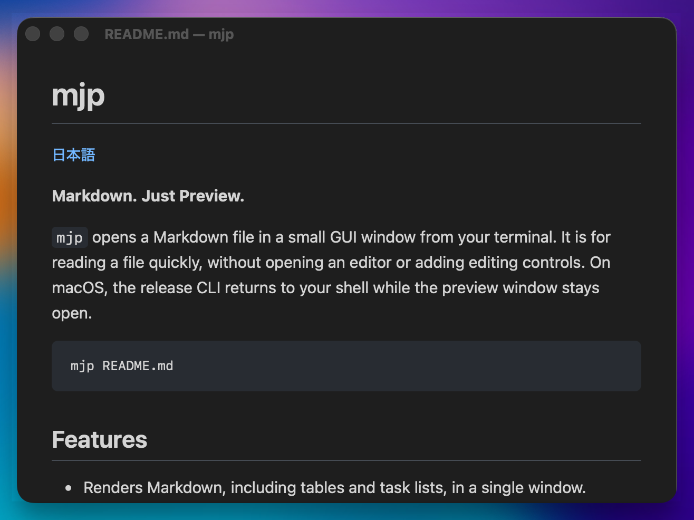

# mjp

[日本語](docs/ja/README.md)

**Markdown. Just Preview.**

`mjp` opens Markdown files in small GUI windows from your terminal or macOS Finder. It is for reading a file quickly, without opening an editor or adding editing controls. On macOS, the release CLI returns to your shell while the preview window stays open.

```sh
mjp README.md
```



## Features

- Renders Markdown, including tables and task lists, with one preview per file.
- Opens `.md` and `.markdown` files from macOS Finder.
- Highlights fenced code blocks for common languages.
- Copies fenced code blocks with a button or keyboard activation.
- Displays local PNG, JPEG, GIF, and WebP images referenced in Markdown.
- Searches within the displayed document in Markdown and plain-text views.
- Follows the system light or dark appearance.
- Reloads the preview when the file changes, preserving the scroll position when possible.
- Supports keyboard navigation and quick closing.
- Returns the shell prompt immediately after opening the window in a macOS release build.

## Usage

```sh
mjp <file>
command | mjp
mjp < README.md
```

Pass exactly one path to a readable, regular UTF-8 file of at most 10 MiB. Relative and absolute paths work. The file extension is not restricted. Errors are printed in the terminal before a window opens. Use `mjp --help` (`-h`) for usage and `mjp --version` (`-V`) for the version. Use `mjp -- -notes.md` to open a file whose name starts with a dash.

With no arguments, `mjp` reads piped or redirected standard input once until EOF, then opens a single preview titled `stdin — mjp`. `mjp -` explicitly selects the same input. Standard input must be UTF-8 and at most 10 MiB; empty input opens an empty preview. On macOS release builds, the CLI returns after handing the text to the GUI, and the window stays open after the producer exits. Standard-input previews do not watch a file or load local images; image alt text remains visible. To preview edits, open the file with `mjp <file>`; saving it updates the preview.

Running `mjp` with no arguments at a terminal shows help. `mjp -` at a terminal reports an error instead of waiting for typed input. An explicit file takes precedence over piped input; use `mjp -- -` to open a file literally named `-`.

Documents up to 128 KiB are formatted as Markdown. Larger documents show their complete source as plain text, with a notice, to keep initial display quick. File previews support live reload in both modes.

Links with `http:`, `https:`, or `mailto:` URLs open in the system's default app. Relative file links are not opened. Raw HTML remains plain text.

### Opening files from Finder

After [installing the app](#installation), select a `.md` or `.markdown` file in Finder and choose **Open With → mjp**. You can also make mjp the default app using the installation steps below, then double-click files to preview them.

The app opens a separate window for each file. Opening the same file again brings its existing window to the front; duplicate requests during a load share that load. Each open request processes its first 10 selected inputs. Excess inputs and files that cannot be read appear together in one **Files that could not be opened** window, with up to 10 details and an omitted count. Correct the file or request, then open it again to retry. Files that opened successfully continue to reload after saves; a later read failure appears in that preview's error banner and clears when the file recovers.

Launching `mjp.app` without a file shows a welcome window with usage instructions. It closes after a document window is successfully created. Each preview closes independently, and mjp exits after the last window closes and all accepted open requests finish. `⌘Q` or **Quit** exits the entire process, including while a file is loading.

The CLI starts with one preview in its own process. Normal Finder launches are expected to deliver files to the existing app instance. Directly using the executable inside `mjp.app` as a CLI can create multiple instances; any CLI child that receives an OS open request adds windows in that same process. For terminal use, install the separate command in `~/.local/bin` as shown below.

### Keyboard shortcuts

| Shortcut | Action |
| --- | --- |
| `⌘F`, `/` | Open search in the current document. |
| `Enter` | Confirm the current match from the search input, close search, and return focus to the document. |
| `n`, `N` | Move to the next or previous match using the last query while search is closed. |
| `Esc` with search open | Cancel search and restore the previous search state and scroll position. |
| `Esc` with search closed and marks visible | Clear the search marks and count badge. |
| `Esc` with search closed and no marks | Close the current preview. |
| `q`, `⌘W` | Close the current preview on macOS (`q` outside the search input). |
| `⌘Q` | Quit all windows in this mjp process. |
| `j`, `k` | Scroll down or up. |
| `Ctrl+D`, `Ctrl+U` | Scroll down or up by half a window. |
| `gg` | Jump to the top (press the two `g` keys within one second). |
| `G` (`Shift+G`) | Jump to the bottom. |

### Finding text

Search follows Vim-style controls. Opening search saves your reading position. Typing updates the matches and scrolls to the first match at or after the top of that saved reading area, accounting for the banner and search panel; if none remains, it wraps to the first match. Reopening an existing query also selects from your new reading position.

Enter confirms the current match, closes the panel, and returns focus to the document. Highlights stay visible, with a count badge such as `[3/12]` at the end of the current matching line. A query with no matches stays editable as `0/0`; an empty query closes search and clears its marks. While open, the panel shows the current position and count. Search keeps the first 1000 matches: exactly 1000 shows `3/1000`, while more shows `3/1000+` (or `[3/1000+]` in the badge); navigation wraps within those stored matches.

Use `n` or `N` to move forward or backward without reopening the panel. If you have scrolled the current match out of view, `n` selects the first match at or after the top of the visible reading area, and `N` selects the last match at or before its bottom. If none remains in that direction, navigation wraps. A match already fully in view advances normally to the next or previous match.

Esc while search is open cancels the edit and restores the previous query, match number, marks, and saved scroll position. With search closed, Esc clears visible marks and the badge while retaining the query and match number; `n` or `N` shows them again and moves. Esc when no marks are visible closes the preview. With search open, `⌘F` refocuses the input and selects its query without changing the saved position. Reading shortcuts such as `j`, `k`, and `q` are inactive in the search input; Enter and Esc are left to the input method during IME composition.

Search covers rendered text, including code, table cells, and link labels, in the current document. Matching ignores case and fullwidth ASCII forms, but does not cross paragraphs, list items, table cells, or explicit line breaks. Alt text for local images eligible for loading is excluded even if loading fails. Alt text for remote images and images beyond the 64-reference limit remains searchable.

Live reload searches again with the same query, keeping the match number if it still exists and otherwise returning to the first match, without requesting a search scroll. The badge follows layout changes, including images loading; it is hidden while the panel is open or no matches remain.

On WebViews without all-match highlight support, typing scrolls to the match chosen from the saved position and leaves the document selection unchanged. Enter confirms and selects the current match with focus in the document; `n` and `N` select their destination match. The same count badge is available. Clearing marks with Esc removes only the selection set by search, preserving a selection you made afterward. `⌘C` uses the WebView's normal copy behavior for the focused input or document selection.

### Copying code

Each fenced code block has a copy button; click it, or press Enter or Space while it has focus. The copied text keeps indentation and trailing newlines, but leaves out control characters and other invisible characters that the preview does not display. Inline code, indented code blocks, and the large-file plain-text view have no button, and reading shortcuts such as `j` are inactive while a button has focus.

### Local images

Use Markdown image syntax, for example ``, with paths relative to the Markdown file. In a Git working tree, images may come from anywhere within the nearest repository root, such as `../images/preview.png`; otherwise they must be in the Markdown file's directory or below it. Symlinks, absolute paths, remote URLs, data URLs, and SVG are not loaded, and unavailable images show their alt text.

Each image is limited to 10 MiB, and a document loads at most 64 image references and 32 MiB of distinct image data. Image files are not watched: after editing only an image, close and reopen the preview, or change and save the Markdown text.

### Yazi + Neovim + mjp

Use Yazi to select a file, Neovim to edit it, and `mjp` to preview saved changes in a separate window. The tools work together through the file; no editor plugin is needed.

This workflow was manually confirmed with Yazi 26.1.22 and the macOS release build of `mjp`. Make sure `mjp` and `nvim` are on your `PATH`. Merge the following into `~/.config/yazi/yazi.toml`, reusing existing sections rather than duplicating them:

```toml
[opener]
markdown = [
  { run = 'mjp -- %s1 && nvim -- %s1', desc = "nvim + mjp", block = true, for = "macos" },
]

[open]
prepend_rules = [
  { url = "*.md", use = "markdown" },
  { url = "*.markdown", use = "markdown" },
]
```

If you already define `open.rules`, you can instead insert these two Markdown rules at the start of that list, before any `text/*` rule, keeping the remaining rules. The `%s1` placeholder passes the first selected file. See [Yazi's opener configuration](https://yazi-rs.github.io/docs/configuration/yazi/#opener) for the configuration syntax. An existing Yazi pane previewer such as `piper` with `bat` can stay in place.

1. Restart Yazi, select one local Markdown file, and press Enter.
2. **mjp takes focus when its window opens. Switch back to the terminal before editing in Neovim.**
3. Save with `:w`; mjp updates the preview automatically.
4. Quit Neovim to return to Yazi. The preview stays open; focus it and press `Esc` or `q` when finished.

The macOS release CLI detaches the preview itself, so `&&` can start Neovim after the CLI succeeds. `block = true` lets Neovim use the terminal until it exits; no `&` or `orphan = true` is needed for this opener. This workflow assumes a release build, not `tauri dev`.

## Installation

The initial distribution is source-only, for macOS Apple Silicon. There is no published binary, installer, or Homebrew package yet.

Windows and Linux support is planned for a later phase; neither is currently supported.

Install [Xcode Command Line Tools](https://v2.tauri.app/start/prerequisites/#macos), Rust 1.90 or newer, and Node.js 24.x (24.22.1 or newer), with npm. Then build from the repository root:

```sh
git clone https://github.com/takanori88/mjp.git
cd mjp
npm ci
npm run build:release -- --bundles app -- --locked
./src-tauri/target/release/mjp README.md
```

The built command is `src-tauri/target/release/mjp`. The app bundle is `src-tauri/target/release/bundle/macos/mjp.app`.

To install the Finder app:

1. In Finder, copy `src-tauri/target/release/bundle/macos/mjp.app` to `/Applications`, giving `/Applications/mjp.app`.
2. Select a `.md` file and choose **File → Get Info** (`⌘I`).
3. Under **Open with**, select **mjp** (use **Other…** to find `/Applications/mjp.app` if needed), then click **Change All…** and confirm.
4. Repeat for a `.markdown` file if you use that extension. Double-click a file to open its preview.

To update the app, quit mjp and replace `/Applications/mjp.app` with a fresh build. Remove that bundle to uninstall the Finder app; the CLI is installed separately.

To install the CLI for your user account:

```sh
mkdir -p "$HOME/.local/bin"
install -m 755 src-tauri/target/release/mjp "$HOME/.local/bin/mjp"
export PATH="$HOME/.local/bin:$PATH"
mjp --version
mjp README.md
```

Add the `export PATH` line to your shell startup file (for example, `~/.zshrc`) to keep it for new terminals. Rebuild and repeat `install` to update; remove `~/.local/bin/mjp` to uninstall. The installed command needs neither Node.js nor Rust at runtime.

Use the copy in `~/.local/bin` for CLI workflows and `/Applications/mjp.app` for Finder. Builds made here are not Developer ID signed or notarized. Binary distribution and its installation experience are deferred.

Use `build:release` for binaries you intend to share. It remaps the build machine's home, Cargo, Rustup, and checkout paths to generic `/build/` paths during compilation, including dependencies. Existing environment-supplied compiler flags are preserved. Direct `cargo build` or `tauri build` commands do not apply this remapping. Check the final executable before distribution because generated strings and linker output may contain other paths.

## Development

The app uses Tauri 2 and Rust for the CLI, window, and file watching, with Vanilla TypeScript, Vite, markdown-it, DOMPurify, and highlight.js for the preview. Development currently targets macOS Apple Silicon. Use Rust 1.90 or newer, Node.js 24.22.1 or newer within the 24.x line, npm, and the macOS development tools required by Tauri. DOM tests use jsdom and Node's built-in test runner with TypeScript support.

```sh
npm ci
npm test
npm run build
cargo test --locked --manifest-path src-tauri/Cargo.toml
npm run build:release -- --bundles app -- --locked
```

See [PROJECT.md](docs/en/PROJECT.md) for the product goals, [PLAN.md](docs/en/PLAN.md) for implementation decisions, and [PERFORMANCE.md](docs/en/PERFORMANCE.md) for measurements.

English is the canonical documentation language. Detailed documents are under [docs/en/](docs/en/), with this README kept at the repository root. Japanese versions are under [docs/ja/](docs/ja/README.md).

## License

mjp is licensed under the [MIT License](LICENSE), copyright 2026 takanori88. Dependencies retain their own licenses; see [third-party dependencies](docs/en/THIRD_PARTY.md). See [RELEASING.md](docs/en/RELEASING.md) for the source-publication procedure.
