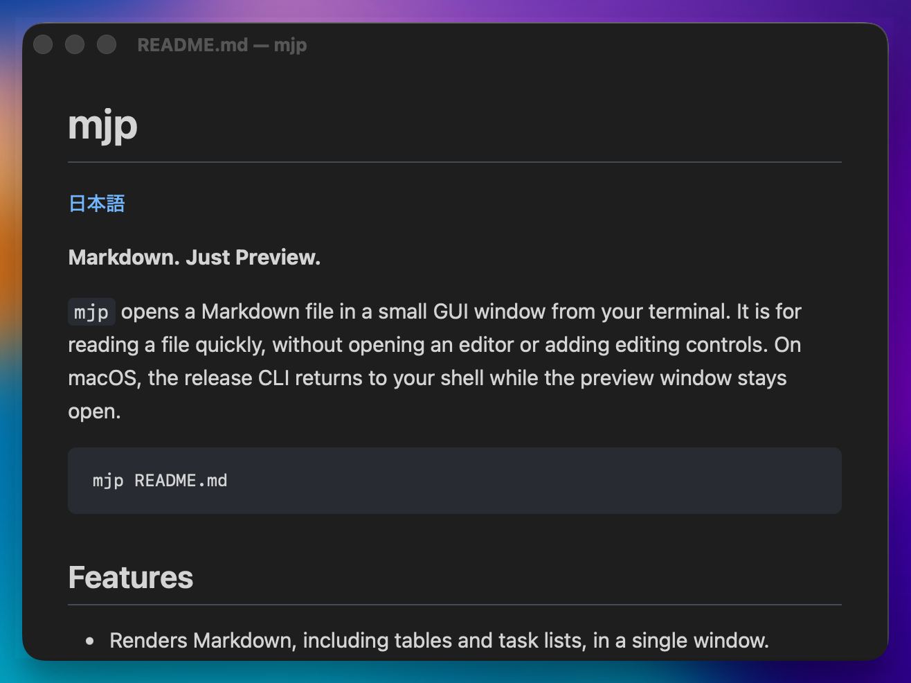

# mjp

[English](../../README.md)

**Markdown. Just Preview.**

`mjp` は、ターミナルや macOS の Finder から Markdown ファイルを小さな GUI ウィンドウで開くツールです。エディタを起動せず、編集用の UI も加えず、素早く読むことに専念します。macOS のリリース版では、プレビューウィンドウを開いたままシェルのプロンプトに戻ります。

```sh
mjp README.md
```



## 機能

- 表やタスクリストを含む Markdown をファイルごとのウィンドウに表示
- macOS の Finder から `.md`・`.markdown` ファイルを開く
- 主な言語の fenced code block をシンタックスハイライト
- フェンス付きコードブロックをボタンやキーボード操作でコピー
- Markdown から参照するローカルの PNG・JPEG・GIF・WebP 画像を表示
- OS のライト／ダーク表示に自動追従
- ファイル変更時に自動更新し、可能な範囲でスクロール位置を維持
- キーボードでの移動と素早い終了
- macOS のリリース版では、ウィンドウを開いたままシェルへ復帰

## 使い方

```sh
mjp <file>
command | mjp
mjp < README.md
```

読み取り可能な通常の UTF-8 ファイルを1つ指定します。上限は 10 MiB です。相対パスと絶対パスに対応し、拡張子による制限はありません。エラーはウィンドウを開く前にターミナルへ出力します。`mjp --help`（`-h`）で使い方、`mjp --version`（`-V`）でバージョンを表示します。名前がハイフンで始まるファイルには `mjp -- -notes.md` を使います。

引数がない場合は、パイプまたはリダイレクトされた標準入力を EOF まで一度だけ読み、`stdin — mjp` というタイトルのプレビューを1つ開きます。`mjp -` でも明示的に同じ入力を選べます。標準入力は UTF-8、最大 10 MiB とし、空入力は空のプレビューを開きます。macOS のリリース版では本文を GUI に渡した後で CLI が終了し、送信元が終了してもウィンドウは残ります。標準入力のプレビューではファイル監視やローカル画像の読み込みを行わず、画像は代替テキストを表示します。編集中の内容を見るには `mjp <file>` でファイルを開くと、保存するたびにプレビューが更新されます。

端末で引数なしの `mjp` を実行すると使い方を表示します。端末での `mjp -` は入力待ちにせずエラーを返します。ファイルを明示した場合はパイプ入力よりファイルを優先します。名前が `-` のファイルは `mjp -- -` で開けます。

128 KiB以下の文書はMarkdownとして整形します。これを超える文書は初回表示を速く保つため、案内とともに全文をプレーンテキストで表示します。ファイルのプレビューはどちらの表示でも自動更新できます。

`http:`、`https:`、`mailto:` のリンクは OS の既定アプリで開きます。相対ファイルリンクは開きません。生の HTML は引き続き文字として表示します。

### Finder から開く

[アプリをインストール](#インストール)したら、Finder で `.md` または `.markdown` ファイルを選び、**このアプリケーションで開く → mjp** を選択します。後述のインストール手順で標準アプリに設定すると、ダブルクリックでプレビューを開けます。

アプリはファイルごとに別ウィンドウを開きます。同じファイルを再び開くと既存のウィンドウを前面に出し、読み込み中の重複要求は同じ読み込みにまとめます。1回のオープン要求では選択した入力の先頭10件を処理します。超過分と読めないファイルは **Files that could not be opened** という1つの案内ウィンドウにまとめ、詳細を10件まで表示して省略件数も示します。ファイルや要求を修正してから開き直すと再試行できます。正常に開いたファイルは保存後に自動更新し、その後の読み込み失敗は各プレビューのエラーバナーに表示して、復旧すると消します。

ファイルなしで `mjp.app` を起動すると、使い方を示す Welcome ウィンドウを表示します。文書ウィンドウの生成が成功すると Welcome を閉じます。各プレビューは個別に閉じられ、最後のウィンドウが閉じて受付済みのオープン要求も完了すると mjp が終了します。`⌘Q` または **Quit** は、ファイル読み込み中でもプロセス全体を終了します。

CLI は独立したプロセスで、起動時に1つのプレビューを開きます。通常の Finder 起動では既存のアプリインスタンスへの配送を期待します。`mjp.app` 内の実行ファイルを CLI として直接使うと複数インスタンスがありうるため、CLI 子が OS のオープン要求を受け取った場合も同じプロセスに追加ウィンドウを開きます。ターミナルでは、後述のとおり別のコマンドを `~/.local/bin` にインストールして使ってください。

### キーボード操作

| キー | 動作 |
| --- | --- |
| `Esc`、`q`、`⌘W` | macOS で現在のプレビューを閉じる |
| `⌘Q` | この mjp プロセスの全ウィンドウを終了する |
| `j`、`k` | 下／上にスクロール |
| `Ctrl+D`、`Ctrl+U` | 半画面分、下／上にスクロール |
| `gg` | 先頭へ移動（2回の `g` を1秒以内に押す） |
| `G`（`Shift+G`） | 末尾へ移動 |

### コードのコピー

各フェンス付きコードブロックにコピーボタンを表示します。クリックするか、フォーカスして Enter または Space を押すとコピーします。インデントと末尾改行は保持し、プレビューに表示されない制御文字などの不可視文字は除きます。インラインコード、インデント式コードブロック、大きなファイルのプレーンテキスト表示にはボタンを付けません。ボタンにフォーカスしている間は `j` などの閲覧用ショートカットが効きません。

### ローカル画像

`` のような Markdown の画像記法を使い、パスは Markdown ファイルからの相対パスで指定します。Git 作業ツリー内では最も近いリポジトリのルート以下の画像（`../images/preview.png` など）を、それ以外では Markdown と同じディレクトリかその配下の画像を参照できます。シンボリックリンク、絶対パス、外部 URL、data URL、SVG は読み込まず、読み込めない画像は代替テキストを表示します。

上限は画像1つにつき 10 MiB、1つの文書につき画像記法64個・重複を除く画像データ合計 32 MiB です。画像ファイルは監視しないため、画像だけを編集したときはプレビューを閉じてから開き直すか、Markdown 本文を変更して保存してください。

### Yazi + Neovim + mjp

Yazi でファイルを選び、Neovim で編集し、`mjp` の別ウィンドウで保存後の表示を確認できます。ファイルを介して連携するため、エディタ用のプラグインは不要です。

この使い方は Yazi 26.1.22 と macOS の mjp リリース版で手動確認しています。`mjp` と `nvim` に `PATH` が通っていることを確認し、次の設定を `~/.config/yazi/yazi.toml` に追加してください。既存のセクションがある場合は、その中に追加してセクションを重複させないでください。

```toml
[opener]
markdown = [
  { run = 'mjp -- %s1 && nvim -- %s1', desc = "nvim + mjp", block = true, for = "macos" },
]

[open]
prepend_rules = [
  { url = "*.md", use = "markdown" },
  { url = "*.markdown", use = "markdown" },
]
```

すでに `open.rules` を定義している場合は、代わりにそのリストの先頭へ上記の Markdown 用ルール2行を追加しても構いません。`text/*` のルールより前に置き、残りのルールは維持してください。`%s1` は選択した最初のファイルを渡します。設定記法は [Yazi の opener 設定](https://yazi-rs.github.io/docs/configuration/yazi/#opener)を参照してください。`piper` と `bat` など、Yazi 内のプレビュー設定はそのまま併用できます。

1. Yazi を再起動し、ローカルの Markdown ファイルを1つ選んで Enter を押します。
2. **起動直後は mjp にフォーカスが移ります。Neovim で編集する前に、ターミナルへフォーカスを戻してください。**
3. `:w` で保存すると、mjp のプレビューが自動更新されます。
4. Neovim を終了すると Yazi に戻ります。プレビューは開いたままなので、読み終えたら mjp にフォーカスして `Esc` または `q` で閉じます。

macOS のリリース版は mjp 自身がプレビューを別プロセスに切り離すため、CLI の成功後に `&&` で Neovim を起動できます。`block = true` は Neovim の終了までターミナルを使えるようにする指定です。この opener に `&` や `orphan = true` は不要です。この使い方はリリース版を前提としており、`tauri dev` は対象外です。

## インストール

初回は macOS Apple Silicon 向けのソース公開です。公開済みのバイナリ、インストーラー、Homebrew パッケージはまだありません。

Windows と Linux への対応は後の段階で予定しており、現時点では未対応です。

[Xcode Command Line Tools](https://v2.tauri.app/start/prerequisites/#macos)、Rust 1.90以降、Node.js 24.x（24.22.1以降）と npm を用意し、リポジトリのルートでビルドします。

```sh
git clone https://github.com/takanori88/mjp.git
cd mjp
npm ci
npm run build:release -- --bundles app -- --locked
./src-tauri/target/release/mjp README.md
```

生成されるコマンドは `src-tauri/target/release/mjp`、アプリバンドルは `src-tauri/target/release/bundle/macos/mjp.app` です。

Finder 用アプリのインストール手順:

1. Finder で `src-tauri/target/release/bundle/macos/mjp.app` を `/Applications` にコピーし、`/Applications/mjp.app` に配置します。
2. `.md` ファイルを選び、**ファイル → 情報を見る**（`⌘I`）を開きます。
3. **このアプリケーションで開く** で **mjp** を選び（見つからない場合は **その他…** で `/Applications/mjp.app` を指定）、**すべてを変更…** を押して確認します。
4. `.markdown` も使う場合は、その拡張子のファイルでも繰り返します。ファイルをダブルクリックするとプレビューが開きます。

更新時は mjp を終了して、新しくビルドした `/Applications/mjp.app` に置き換えます。このバンドルを削除すると Finder 用アプリをアンインストールできます。CLI は別にインストールします。

ユーザーアカウント用の CLI としてインストールするには、次を実行します。

```sh
mkdir -p "$HOME/.local/bin"
install -m 755 src-tauri/target/release/mjp "$HOME/.local/bin/mjp"
export PATH="$HOME/.local/bin:$PATH"
mjp --version
mjp README.md
```

新しいターミナルでも使えるよう、`export PATH` の行を `~/.zshrc` などのシェル起動ファイルに追加してください。更新時は再ビルドして `install` を繰り返し、削除時は `~/.local/bin/mjp` を削除します。インストールしたコマンドの実行に Node.js や Rust は不要です。

CLI の操作には `~/.local/bin` のコピーを、Finder には `/Applications/mjp.app` を使います。ここで作成するビルドは Developer ID 署名・公証を行いません。バイナリ配布と、そのインストール体験の整備は後の段階です。

共有するバイナリは `build:release` で作成してください。依存ライブラリを含むコンパイル時に、ビルド環境のホーム、Cargo、Rustup、チェックアウトのパスを共通の `/build/` 配下のパスへ置き換えます。環境変数で指定された既存のコンパイラフラグは保持します。`cargo build` や `tauri build` を直接実行した場合、この置換は適用されません。生成された文字列やリンカーの出力には別のパスが含まれる可能性があるため、配布前には完成した実行ファイルを確認してください。

## 開発

CLI、ウィンドウ、ファイル監視には Tauri 2 と Rust を使用します。プレビューは Vanilla TypeScript、Vite、markdown-it、DOMPurify、highlight.js で構成しています。開発・検証対象は現在 macOS Apple Silicon です。Rust 1.90以降、Node.js 24.xの24.22.1以降、npm、Tauriが要求するmacOS開発ツールを使用してください。DOMテストにはjsdomとTypeScriptに対応したNode標準テストランナーを使います。

```sh
npm ci
npm test
npm run build
cargo test --locked --manifest-path src-tauri/Cargo.toml
npm run build:release -- --bundles app -- --locked
```

製品の目的は [PROJECT.md](PROJECT.md)、設計判断は [PLAN.md](PLAN.md)、測定結果は [PERFORMANCE.md](PERFORMANCE.md) を参照してください。

英語版を標準文書とし、詳細文書は [docs/en/](../en/)、英語の README は[リポジトリのルート](../../README.md)に置いています。日本語版は `docs/ja/` に置いています。

## ライセンス

mjp は [MIT License](../../LICENSE) です。著作権表示は 2026 takanori88 としています。依存物には各プロジェクトのライセンスが適用されます。[第三者の依存物](THIRD_PARTY.md) と、ソース公開手順の [RELEASING.md](RELEASING.md) を参照してください。
